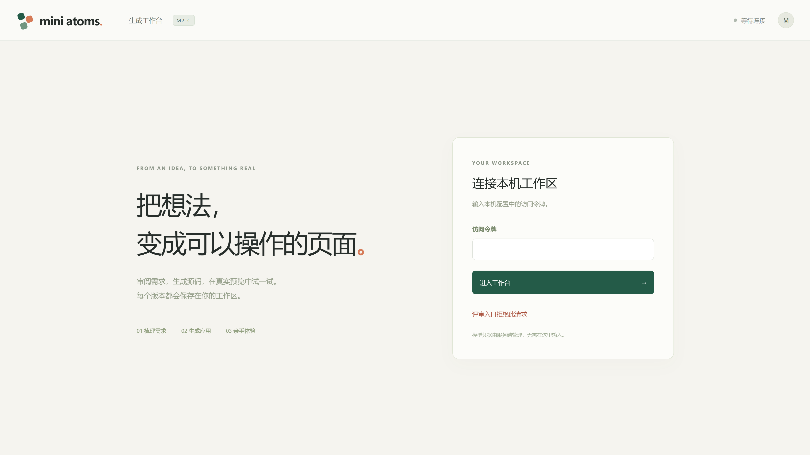

# Mini Atoms

**不只是生成应用，而是验证 AI 生成的应用是否真的符合需求。**

Mini Atoms 是一个 Evidence-Driven AI App Builder（证据驱动的 AI 应用构建器）。

你只需要用自然语言描述想要的功能，AI 就会将需求整理成规格说明、生成 React 应用并提供可交互预览。

但 Mini Atoms 不会止步于“页面生成成功”。

它还会尝试把需求变成可执行的浏览器测试，实际操作生成的应用，并保留截图、操作记录和运行结果，让用户知道：

**哪些功能经过测试？哪些测试通过了？哪些需求仍然缺乏足够证据？**

**在线演示：** https://demo.mini-atoms.win（需获得临时评审访问权限）



## 为什么做 Mini Atoms？

AI 编写代码已经越来越容易，但生成代码与验证结果之间存在一个重要差距：

**“AI 说它完成了”和“应用实际上按要求工作”不是同一回事。**

例如，你让 AI 创建一个计数器。

AI 可以迅速生成页面，也可以告诉你按钮已经实现。但如果没有真正运行应用，我们怎么知道按钮点击后是否正确改变数字？

Mini Atoms 尝试把生成与验证连接起来。

## Mini Atoms 的四个核心特点

### 1. 从一句需求到真正可运行的应用

输入自然语言需求，AI 生成需求规格和 React/TSX 代码；系统在隔离环境中编译，并通过浏览器提供实际可交互的预览。

生成的应用并不拥有宿主机或 Docker 的直接执行权限。

### 2. 不让 AI 自己决定测试是否通过

AI 可以提出测试计划，但不能因为它认为代码正确，就直接宣布测试成功。

Mini Atoms 通过确定性 Policy 检查具体测试操作及其授权范围，然后交由真实 Chromium 浏览器执行。

简单来说：

**AI 负责提出测试方法，受控程序决定能做什么，真实浏览器负责产生观察结果。**

### 3. 用证据支撑结论，而不是只显示一个 PASS

每次正式验证都会保存与应用版本绑定的证据，例如：

- 实际测试步骤与执行结果
- 浏览器截图
- 浏览器日志与运行报告
- 可追溯的 Trace

用户不仅能够看到结论，还能查看结论的依据。

### 4. 知道哪些事情还不能证明

这是 Mini Atoms 特别强调的一点：

**测试通过，不代表整个需求已经被完整证明。**

例如，计数器在某次测试中成功从 0 变成 1，只能说明这次操作通过，不能自动证明它在所有输入和状态下都正确。

因此，Mini Atoms 区分测试观察、需求判定和覆盖程度，对证据不足的需求保留 `UNVERIFIED`，而不是为了展示好看的结果强行标记 PASS。

## 从需求到证据

```text
自然语言 → Specification → React/TSX → 隔离 esbuild → AppVersion
                                                    ↓
                                    trusted shell → opaque iframe Preview
                                                    ↓
TestPlan Proposal → 确定性 Policy → Authorization → Chromium → Evidence
```

Builder 的可信 Node Controller 管理 API、SQLite、任务和不可变版本；生成代码在原 M0.5 Compiler / Preview / Validator 隔离边界内运行。模型提出计划，Policy 决定可执行的步骤，正式 Runner 执行并登记证据。模型不持有 Docker、数据库或宿主执行权限。

## 本地准备与构建

- Node.js **>=24.19.0、<25**、npm，以及 Git。
- 完整运行还需要 Docker Engine / Docker Desktop、Compose v2，以及下述精确锁定的 OCI 镜像。Compose 必须支持现有配置中的 `!override` 和隔离网络，不能删减安全选项来适配旧版本。
- 两个活动包都使用提交的锁文件安装依赖。以下命令在仓库根目录逐条执行：

```sh
npm --prefix spikes/m0-5-tsx-runtime ci --ignore-scripts --no-audit --no-fund
npm --prefix apps/builder ci --ignore-scripts --no-audit --no-fund
node apps/builder/node_modules/typescript/bin/tsc --noEmit --project apps/builder/tsconfig.json
npm --prefix apps/builder run build
npm --prefix apps/builder test
npm --prefix spikes/m0-5-tsx-runtime run test:build
```

这些检查不需要 Provider 凭据。API / Provider 单元测试使用本地确定性夹具，不构成真实 LLM 或容器验收。`test:build` 实际运行受控编译器并检查合法与拒绝输入，会生成被 Git 忽略的本地结果。

### 完整运行所需的锁定镜像

运行时必须安装 `apps/builder/runtime.lock.json` 的 `imageId` 对应的已验证镜像，并满足同文件的 31 个冻结源码摘要及 `runtime-hashes.json` 的容器文件摘要。当前镜像身份是：

```text
sha256:f38bb8f6b93c4fc202fa3d2e88e5fc3dc41ddfaf1ae78061552362fa5dce1a2b
```

OCI 镜像归档不在源码仓库中，其公开分发方式尚待维护者确定。取得获批准的归档后执行 `docker load --input <archive>`，用 `docker image inspect <imageId> --format '{{.Id}}'` 核对实际身份。Dockerfile 和固定基础镜像已提供，但重新构建不保证得到同一 OCI image ID；不要修改锁文件来绕过运行检查。**当前可从干净源码复现安装、类型检查和构建；从零启动完整沙箱仍以取得该镜像为前提。**

### 私有配置与启动

```sh
npm --prefix apps/builder run setup
```

该命令在 `apps/builder/.env.local` 生成独立的本机访问令牌，已有文件会保留。仅在本机编辑文件，例如：

```dotenv
LLM_BASE_URL=https://api.deepseek.com
LLM_MODEL=deepseek-flash
LLM_API_KEY=
```

将自己的 API Key 填入空值并保存，不提交 `.env.local`。`M1_PUBLIC_ORIGIN` 保持空值即为 localhost 模式，数据默认存入被忽略的 `apps/builder/.local`。未配置 Provider 时不能生成，但可以读取自己的已有版本和证据。

```sh
npm --prefix apps/builder run runtime:check
npm --prefix apps/builder start
```

打开 `http://127.0.0.1:8120`，使用本机 `.env.local` 中的 `M1_ACCESS_TOKEN` 进入工作台。Main 仅监听 loopback，Preview 使用 loopback 8092。原始生成 HTML 的顶层访问受限，通过工作台的受控外壳预览。

新建项目 → 输入需求 →「梳理需求」→ 审阅需求 →「生成应用」。为走 v1.1，关闭「生成后规划验证（另计调用）」，生成版本后显式选择 v1.1 规划，再执行验证。Spec、源码和规划分别可能消耗模型调用，合同纠正也计入额度；传输失败不自动重试。

停止 Builder 使用 Ctrl+C；需要停止该项目 Preview 时执行 `npm --prefix apps/builder run runtime:down`。Linux 服务、发布包及备份操作见 [部署说明](docs/Deployment-Runbook.md)，评审入口见 [Gateway 说明](docs/Review-Gateway-Runbook.md)。

## v0.1 与 v1.1

| | v0.1 | v1.1 |
| --- | --- | --- |
| 定位 | 冻结的有限动作及固定 Worker profile | 显式的 Typed DSL Proposal 和确定性授权 |
| 目标 | 需求作用域内的固定标识；部分生成 DOM 不被旧 Worker 支持 | 精确版本的 TargetBinding 与支持的控件类型 |
| 前置条件 | 固定输入格式与有限操作 | 经授权的 Setup Bundle；受限 CREATE_ONE |
| 执行 | 原 v0.1 Worker | 原 v1.1 Policy / Runner；总步骤上限仍为 20 |

不支持的行为必须显示 UNVERIFIED / 拒绝，不能通过放宽 Schema 或跨版本挪用计划解决。v1.1 的有限样本也不等于对复杂需求的完全证明。

## 如何理解验证结果

- **Coverage**：计划对需求覆盖到什么程度，包括缺失或只覆盖一部分。
- **Test Observation**：某次实际测试的 PASS / FAIL 等观察；Run 的 ERROR / CANCELLED 等执行状态另行展示。
- **Requirement Verdict**：结合验收范围、覆盖程度和证据对需求给出的结论；Test PASS 不自动成为 Requirement PASS。
- **Evidence**：绑定 Run / 版本并核对摘要的报告、截图、日志与 Trace。人工接受另行记录，不改写测试结果。

## 已验证能力与限制

已在本机及受控 ECS 环境验证生成、编译、持久化、Preview 和正式 Chromium 证据链；固定 HTTPS 入口完成过一次真实 DeepSeek 计数器闭环。该次 3 次模型调用生成 Spec、TSX 和 v1.1 计划，Policy ALLOW，3 条测试实际 PASS，登记 45 份 Evidence；有限断言下 Requirement Verdict 仍为 UNVERIFIED、Coverage 为 PARTIAL。

历史受控 Todo Setup、表单 / 记账 Typed DSL，以及 FAIL / ERROR / CANCELLED 等展示能力经过验证；受控计划不能冒充真实 LLM 规划。公开仓库不附带私有数据库、用户需求、历史 Evidence / Trace 或部署身份；首次启动为空工作区。历史 M2-B 专项 Planner 正例门禁与完整真实在线 R4 门禁不能因单个交付案例自动视为全部关闭。

尚未实现 M3 自动修复、多租户 / 账户系统、匿名公开生成或长期容量保证。Provider 曾出现响应头正常而正文超时，仍可能影响生成可用性；不以 HTTP 200 或局部测试 PASS 宣称完整成功。

源码布局和交付范围见 [交付概览](docs/Submission-Overview.md)。[冻结 v0.1 设计基线](docs/Mini-Atoms-v0.1-FROZEN-Design-Guide.md)按原字节保留，其中的阶段状态和内部证据引用是当时的历史上下文。

## 项目范围与后续方向

Mini Atoms 是一次聚焦于 AI 应用生成、授权验证与证据追溯的工程原型，而不是已经商业化的多用户开发平台。

当前版本优先完成并实际验证了核心端到端流程：自然语言需求、代码生成、应用预览、真实浏览器验证以及证据保存。

为了控制开发范围，以下能力留待后续迭代：

- **自动修复与重新验证（M3）**：在发现问题后，受控地提出修改并再次验证。
- **多用户与工作区隔离**：当前以单用户工作区为基础，尚未实现完整账户和多租户管理。
- **更广泛的验证能力**：当前 Typed DSL 只能验证支持范围内的行为，不能覆盖任意应用的全部需求。
- **长期运行与容量评估**：已进行受控 ECS 部署及实际浏览器验收，但尚未建立长期可用性或大规模并发保证。

当前 Demo 使用受限访问和模型调用预算，而非匿名无限生成。这是为了控制模型成本、用户数据访问及生成代码的运行风险。

真实生成依赖外部 LLM Provider。开发过程中曾观察到响应头已返回、但正文超时的情况；后续真实端到端生成已成功，但外部服务可用性仍不是系统能够完全保证的。

**当前重点是证明一条真实、可追溯的 AI 生成与验证闭环，而不是声称所有需求都能被自动验证或修复。**

## Copyright and Usage

Copyright © 2026 GotoMiyuki. All rights reserved.

This repository is publicly available for technical review and demonstration purposes.

No open-source license is granted. Except where permitted by applicable law or third-party licenses, reproduction, modification, redistribution, or commercial use of the original project materials requires prior written permission from the respective rights holders.

Third-party components remain subject to their respective licenses.